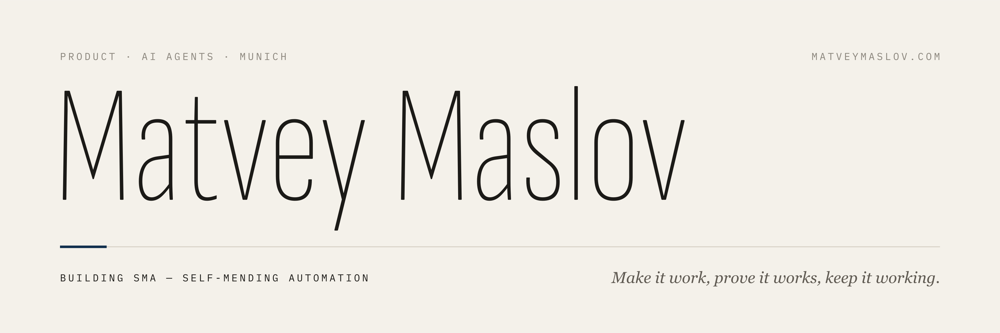

<picture>
  <source media="(prefers-color-scheme: dark)" srcset="assets/banner-dark.png">
  
</picture>

I build **SMA (Self-Mending Automation)**, a personal orchestrator for AI agents. Agents do the work, deterministic gates decide whether it's done, and the process around them improves itself. The code is closed. The ideas, the numbers and a few tools are open.

&nbsp;

###### WRITING

**[SMA Research](https://github.com/matveymaslov/sma-research)** 
Field notes from building SMA: ideas and numbers, no code.

`2026.11.25` &nbsp; [Seven principles for an AI agent fleet you can actually trust](https://github.com/matveymaslov/sma-research/blob/main/2026-11-25-seven-principles/README.md) 
`2026.11.20` &nbsp; [The model is the unreliable part](https://github.com/matveymaslov/sma-research/blob/main/2026-11-20-the-model-is-the-unreliable-part/README.md) 
`2026.11.16` &nbsp; [Every hole in our agent's guards was the same bug](https://github.com/matveymaslov/sma-research/blob/main/2026-11-16-guards-read-what-runs/README.md)

**[Agent work graphs](https://github.com/matveymaslov/agent-work-graphs)** 
How to make AI agents autonomous without losing control: the pain of building work graphs, and a 20-question self-check.

&nbsp;

###### TOOLS

**[agent-dev-tools](https://github.com/matveymaslov/agent-dev-tools)** 
Small, dependency-light tools for people who run AI coding agents. Each one was born from a real failure.

**[security-maxxing-fable5](https://github.com/matveymaslov/security-maxxing-fable5)** 
A hook-enforced security and quality regression guard for Claude Code projects.

&nbsp;

###### ELSEWHERE

[matveymaslov.com](https://www.matveymaslov.com)

&nbsp;

---

Munich &nbsp;·&nbsp; Make it work, prove it works, keep it working.
